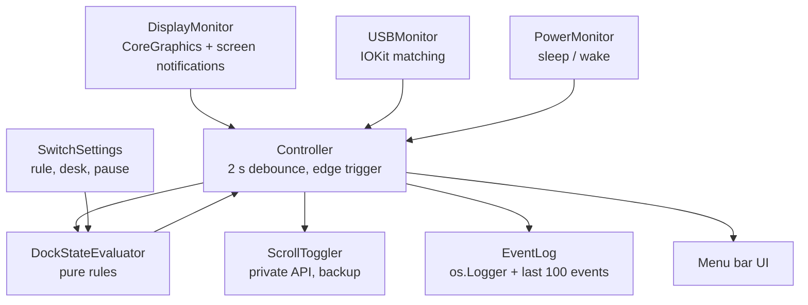
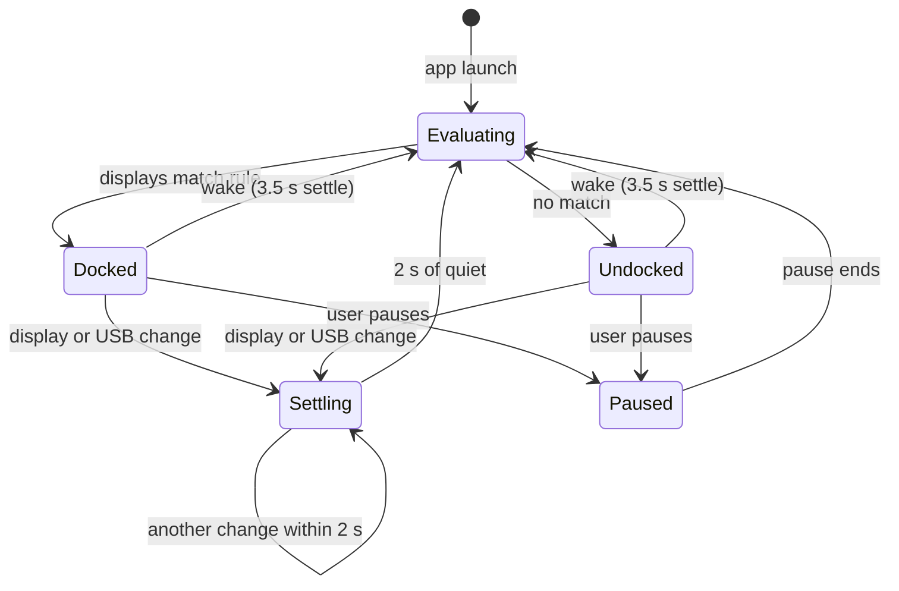

# ScrollSwitch

A small macOS menu bar app that turns **Natural scrolling OFF when the Mac is docked**
(external monitors connected) and **ON when it is undocked** (just the laptop and
trackpad). The change applies live, with no logout and no trip to System Settings.

| Situation | External displays | Natural scrolling |
|---|---|---|
| At the desk, docked, lid closed | 1 or 2 | **OFF** (mouse scrolls the normal way) |
| Away from the desk, lid open | 0 | **ON** (trackpad feels natural) |

## Install

Requires macOS 13 or newer and the Xcode command-line tools.

```bash
make install     # builds, signs ad hoc, copies to /Applications, launches
```

The first launch from `/Applications` registers ScrollSwitch to open at login (turn it off
in Settings or in System Settings › General › Login Items). Update later by running
`make install` again. `make uninstall` removes it.

## Using it

The menu bar icon is a **mouse** when Natural scrolling is OFF and a **hand** when it is ON.
A pause badge means automatic switching is paused, and a dot means something went wrong
(see Recent activity).

```
● Docked: 2 external displays
  Natural scrolling: OFF
─────────────────────────
  ✓ Automatic switching
  Pause for 1 hour
  Pause until I unplug
  Pause indefinitely
─────────────────────────
  Turn Natural scrolling ON now
─────────────────────────
  Save current setup as my desk
  Recent activity…
  Settings…
  Quit ScrollSwitch
```

- **Turn Natural scrolling ON/OFF now** is a one-time flip. Automation picks up again at the
  next plug or unplug.
- **Save current setup as my desk** remembers the connected monitors, so the "My desk"
  rules can ignore projectors and TVs.

### Settings

| Setting | Options |
|---|---|
| Count as docked when | Any external display (default) · My desk is connected · My desk is fully connected · My USB device is connected · Desk display or USB device |
| If the lid is open while docked | Treat as docked (default) · Treat as undocked |
| Natural scrolling when docked / undocked | OFF / ON by default, either can be changed |
| Notifications | Off by default. Permission is asked only when you turn it on |
| Open at login | On after the first launch from /Applications |

## How it works





- **It acts on changes, not constantly.** The setting is written only when the dock state
  changes, plus once at launch, after wake, and on resume. If you flip Natural scrolling by
  hand while docked, ScrollSwitch leaves it alone until the next plug or unplug.
- **Debounce.** One cable pull fires several display events. The controller waits for 2 s
  of quiet (3.5 s after wake) before deciding, so plugging in a KVM causes one flip.
- **Live toggle.** Natural scrolling is set through `setSwipeScrollDirection` in the
  private `PreferencePanesSupport.framework`, the same function System Settings uses.
  Writing `com.apple.swipescrolldirection` alone does not apply until logout. If a future
  macOS removes the function, the app falls back to writing the preference and posting the
  change notification, and shows a warning in the menu.
- **No sandbox.** The App Sandbox blocks writing the global preference, so the app is not
  sandboxed and cannot ship on the Mac App Store. It needs no Accessibility or Input
  Monitoring permission.

## Project layout

```
Sources/
  ScrollSwitchCore/      all logic, no UI
    Core/                ScrollToggler, DisplayMonitor, USBMonitor, PowerMonitor, LidState,
                         DockStateEvaluator, SwitchPolicy, Controller
    Model/               DisplayInfo, USBDeviceID, DeskProfile, Settings
    Support/             EventLog, SettingsStore, LaunchAtLogin, Notifier, SwitchStats
  ScrollSwitch/          SwiftUI MenuBarExtra app and windows
  scrollswitch-cli/      Phase 1 engine and diagnostics
Tests/ScrollSwitchCoreTests/
Spike/                   Phase 0 feasibility scripts
Resources/               Info.plist (LSUIElement), entitlements, icon
docs/                    spec, hardware notes, test plan
```

It is a Swift package rather than an Xcode project. The `Makefile` turns the SwiftPM binary
into a signed `ScrollSwitch.app`.

## Command-line tool

```bash
make cli
.build/release/scrollswitch-cli status    # displays, lid, USB, Natural value, the app's decision
.build/release/scrollswitch-cli devices   # USB vendor and product IDs
.build/release/scrollswitch-cli set off   # set Natural scrolling once
.build/release/scrollswitch-cli watch     # the engine without the app (quit the app first)
```

## Development

```bash
make test     # unit tests: every evaluator rule, pause modes, debounce, edge triggering
make spike    # Phase 0: flips Natural scrolling once on this Mac (run again to flip back)
log stream --predicate 'subsystem == "com.abhirampurohit.scrollswitch"' --info
```

See [`docs/SPEC.md`](docs/SPEC.md) for the full build spec,
[`docs/hardware-notes.md`](docs/hardware-notes.md) for the Phase 0 results and
[`docs/test-plan.md`](docs/test-plan.md) for the Phase 6 checklist.

## License

MIT
