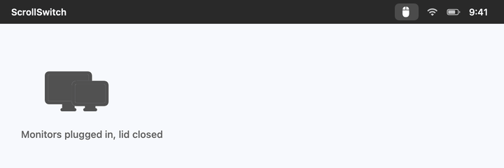
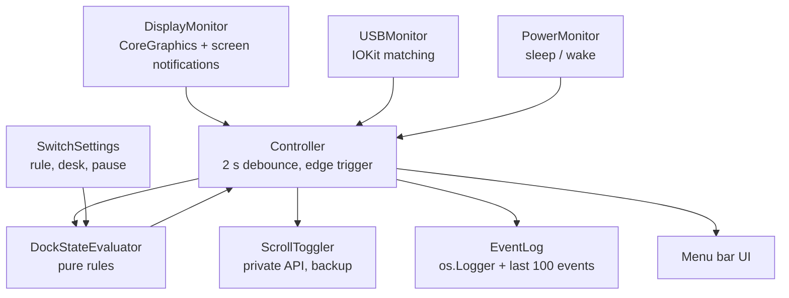
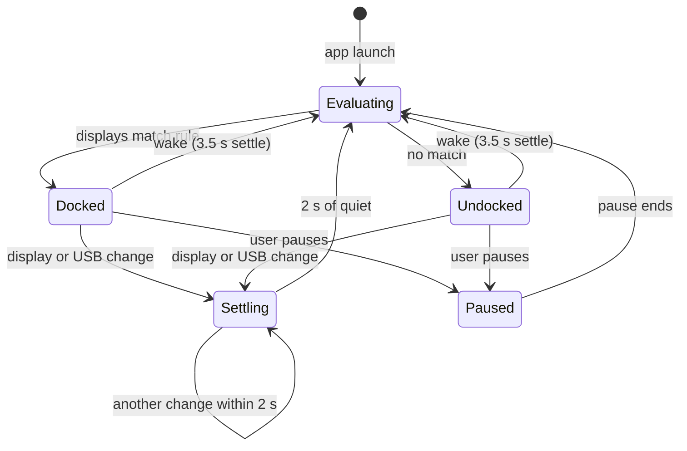

# ScrollSwitch

A small macOS menu bar app that turns **Natural scrolling OFF when the Mac is docked**
(external monitors connected) and **ON when it is undocked** (just the laptop and
trackpad). The change applies live, with no logout and no trip to System Settings.

| Situation | External displays | Natural scrolling |
|---|---|---|
| At the desk, docked, lid closed | 1 or 2 | **OFF** (mouse scrolls the normal way) |
| Away from the desk, lid open | 0 | **ON** (trackpad feels natural) |

<p align="center"></p>

<p align="center">
  <a href="https://github.com/abhip1008/scrollswitch/releases/latest"><b>Download for macOS</b></a> ·
  macOS 13+ · Apple silicon and Intel · free and open source
</p>

## Download and install

Works on macOS 13 or newer, on Apple silicon and Intel Macs.

### Option 1: download the app (easiest)

1. Go to the [**Releases page**](https://github.com/abhip1008/scrollswitch/releases/latest)
   and download **`ScrollSwitch-1.0.0.zip`**.
2. Double-click the zip to unzip it, then drag **ScrollSwitch.app** into your
   **Applications** folder.
3. The app is not notarized by Apple, so macOS blocks it the first time. Open **Terminal**
   and run this once:

   ```bash
   xattr -dr com.apple.quarantine /Applications/ScrollSwitch.app
   ```

   (Or try to open it, then go to **System Settings › Privacy & Security** and click
   **Open Anyway**.)
4. Open **ScrollSwitch** from Applications. There is no window and no Dock icon. Look for
   the new icon in the **menu bar** at the top right of the screen.

### Option 2: build from source

Needs Xcode or the Xcode command-line tools (`xcode-select --install`).

```bash
git clone https://github.com/abhip1008/scrollswitch.git
cd scrollswitch
make install     # builds, signs, copies to /Applications and launches it
```

### After installing

- ScrollSwitch **opens at login automatically** after the first launch from
  /Applications. Turn that off in its Settings or in System Settings › General › Login Items.
- **No permissions are needed.** It does not ask for Accessibility or Input Monitoring.
- **To update**, quit it from the menu bar, replace the app in /Applications (or run
  `make install` again) and open it.
- **To uninstall**, quit it from the menu bar and drag it from Applications to the Trash
  (or run `make uninstall`).

## How to use it

**There is nothing to set up.** Leave it running:

1. **Plug in your monitors** (KVM, HDMI, a dock, anything). About 2 seconds later Natural
   scrolling turns **OFF**, so the mouse wheel scrolls the normal way.
2. **Unplug and use the laptop on its own.** About 2 seconds later (3 to 4 seconds if the
   Mac was asleep) Natural scrolling turns **ON** for the trackpad.

The menu bar icon shows the current state at a glance: a **mouse** means Natural
scrolling is OFF and a **hand** means it is ON.

Optional, if you plug into other screens (a projector, a TV, a monitor at school or work):
while at your own desk, click the menu bar icon, choose **Save current setup as my
desk**, then in **Settings…** set **Count as docked when** to **My desk is connected**.
Other screens will then leave Natural scrolling alone.

If you change the setting yourself in System Settings, ScrollSwitch leaves your choice
alone until the next time you plug in or unplug.

## The menu

The menu bar icon is a **mouse** when Natural scrolling is OFF and a **hand** when it is ON.
A pause badge means automatic switching is paused, and a dot means something went wrong
(see Recent activity).

```
● Docked: 2 external displays
  Natural scrolling: OFF
─────────────────────────
  ✓ Automatic switching
  Pause for 1 hour
  Pause until I unplug
  Pause indefinitely
─────────────────────────
  Turn Natural scrolling ON now
─────────────────────────
  Save current setup as my desk
  Recent activity…
  Settings…
  Quit ScrollSwitch
```

- **Turn Natural scrolling ON/OFF now** is a one-time flip. Automation picks up again at the
  next plug or unplug.
- **Save current setup as my desk** remembers the connected monitors, so the "My desk"
  rules can ignore projectors and TVs.

### Settings

| Setting | Options |
|---|---|
| Count as docked when | Any external display (default) · My desk is connected · My desk is fully connected · My USB device is connected · Desk display or USB device |
| If the lid is open while docked | Treat as docked (default) · Treat as undocked |
| Natural scrolling when docked / undocked | OFF / ON by default, either can be changed |
| Notifications | Off by default. Permission is asked only when you turn it on |
| Open at login | On after the first launch from /Applications |

## Why not Scroll Reverser, LinearMouse or Mos?

Those are good apps, and they take a different approach: they leave Natural scrolling on
and reverse each mouse-wheel event as it happens. Pick the one that fits how you work.

| | ScrollSwitch | Scroll Reverser, LinearMouse, Mos, UnnaturalScrollWheels |
|---|---|---|
| How it works | Flips the real system setting when you dock or undock | Intercepts and reverses every scroll event |
| Permissions | **None** | Accessibility |
| Work while you scroll | **None**, it only acts on plug and unplug | Every scroll passes through the app |
| Smooth-scrolling or free-spin mice | **Not affected** | Have to guess mouse vs trackpad per event, which can misfire |
| Mouse and trackpad used at the same moment | No, one setting at a time | **Yes** |
| Extra mouse features (acceleration, buttons, smooth scroll) | No | **Yes**, in LinearMouse and Mos |

**Use ScrollSwitch** if your mouse lives at a desk, the trackpad is for when you are away
from it (especially in clamshell mode), and you would rather not grant Accessibility
access to anything. **Use one of the others** if you switch between the mouse and the
trackpad within the same session, or want more mouse tuning.

## How it works





- **It acts on changes, not constantly.** The setting is written only when the dock state
  changes, plus once at launch, after wake, and on resume. If you flip Natural scrolling by
  hand while docked, ScrollSwitch leaves it alone until the next plug or unplug.
- **Debounce.** One cable pull fires several display events. The controller waits for 2 s
  of quiet (3.5 s after wake) before deciding, so plugging in a KVM causes one flip.
- **Live toggle.** Natural scrolling is set through `setSwipeScrollDirection` in the
  private `PreferencePanesSupport.framework`, the same function System Settings uses.
  Writing `com.apple.swipescrolldirection` alone does not apply until logout. If a future
  macOS removes the function, the app falls back to writing the preference and posting the
  change notification, and shows a warning in the menu.
- **No sandbox.** The App Sandbox blocks writing the global preference, so the app is not
  sandboxed and cannot ship on the Mac App Store. It needs no Accessibility or Input
  Monitoring permission.

## Project layout

```
Sources/
  ScrollSwitchCore/      all logic, no UI
    Core/                ScrollToggler, DisplayMonitor, USBMonitor, PowerMonitor, LidState,
                         DockStateEvaluator, SwitchPolicy, Controller
    Model/               DisplayInfo, USBDeviceID, DeskProfile, Settings
    Support/             EventLog, SettingsStore, LaunchAtLogin, Notifier, SwitchStats
  ScrollSwitch/          SwiftUI MenuBarExtra app and windows
  scrollswitch-cli/      Phase 1 engine and diagnostics
Tests/ScrollSwitchCoreTests/
Spike/                   Phase 0 feasibility scripts
Resources/               Info.plist (LSUIElement), entitlements, icon
docs/                    spec, hardware notes, test plan
```

It is a Swift package rather than an Xcode project. The `Makefile` turns the SwiftPM binary
into a signed `ScrollSwitch.app`.

## Command-line tool

```bash
make cli
.build/release/scrollswitch-cli status    # displays, lid, USB, Natural value, the app's decision
.build/release/scrollswitch-cli devices   # USB vendor and product IDs
.build/release/scrollswitch-cli set off   # set Natural scrolling once
.build/release/scrollswitch-cli watch     # the engine without the app (quit the app first)
```

## Development

```bash
make test     # unit tests: every evaluator rule, pause modes, debounce, edge triggering
make spike    # Phase 0: flips Natural scrolling once on this Mac (run again to flip back)
make release  # universal app zipped as build/ScrollSwitch-<version>.zip for a GitHub Release
log stream --predicate 'subsystem == "com.abhirampurohit.scrollswitch"' --info
```

See [`docs/SPEC.md`](docs/SPEC.md) for the full build spec,
[`docs/hardware-notes.md`](docs/hardware-notes.md) for the Phase 0 results and
[`docs/test-plan.md`](docs/test-plan.md) for the Phase 6 checklist.

## License

MIT
