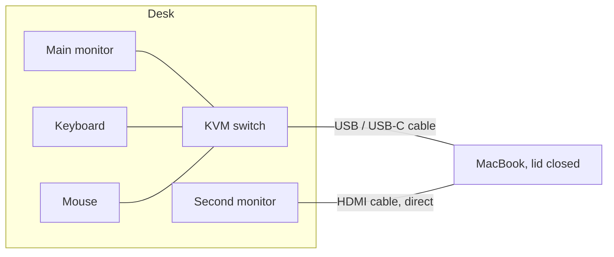
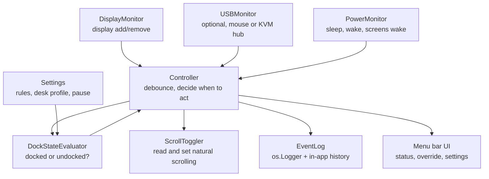
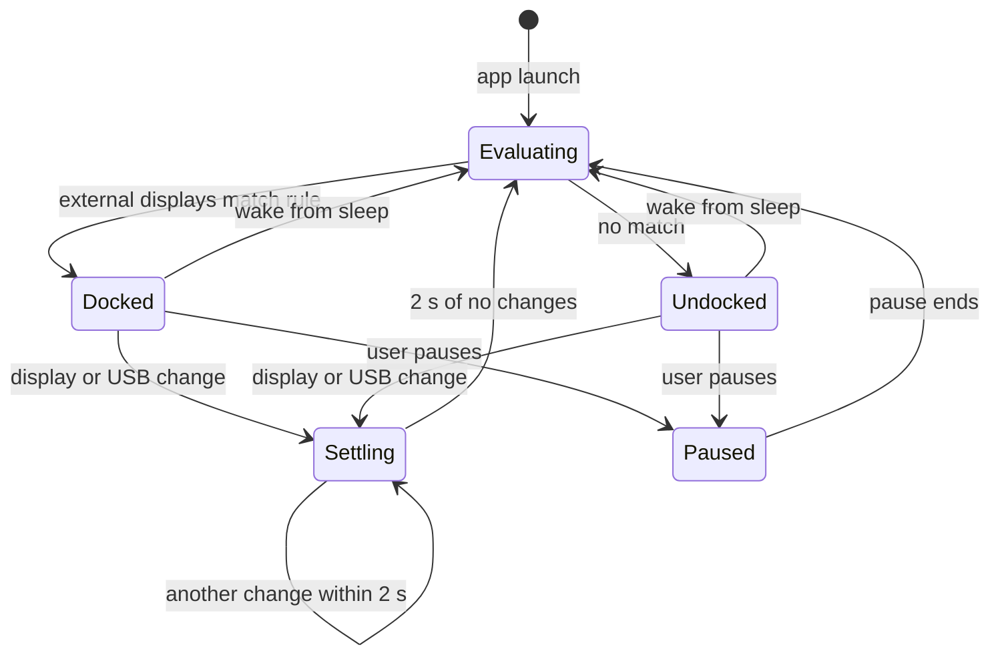

# ScrollSwitch: Full Build Spec

A small macOS menu bar app that turns **Natural scrolling OFF when the Mac is docked** (external monitors connected) and **ON when it is undocked** (just the laptop and trackpad). No more opening System Settings every time you sit down or leave the desk.

---

## 1. The problem

Natural scrolling on macOS is one global setting. It feels right on the trackpad and wrong on a mouse wheel. Right now the setting has to be flipped by hand every time the Mac moves between the desk and the laptop-only setup.

ScrollSwitch watches for the desk setup and flips the setting automatically.

---

## 2. The physical setup



- **Docked:** KVM cable plugged into the Mac (main monitor, keyboard, mouse come through it), second monitor plugged in by HDMI, lid closed, Mac runs in clamshell mode with the monitors as the displays.
- **Undocked:** Cables pulled, lid open, only the built-in display and trackpad.

### What the app should do

| Situation | External displays | Natural scrolling |
|---|---|---|
| At the desk, docked, lid closed | 1 or 2 | **OFF** (mouse scrolls the normal way) |
| Away from desk, lid open | 0 | **ON** (trackpad feels natural) |

---

## 3. Goals and non-goals

### Goals
1. Detect docked vs undocked automatically, with no clicks.
2. Set Natural scrolling to the right value within about 2 to 3 seconds of plugging or unplugging.
3. Apply the change **live**, with no logout, restart, or opening System Settings.
4. Survive sleep, wake, restarts, and KVM flicker without getting confused.
5. Start automatically at login and stay out of the way (menu bar only, no Dock icon).
6. Give a manual override when the automatic choice is wrong.

### Non-goals (for v1)
- Mac App Store distribution (the toggle needs a private system function and no sandbox, so the App Store is not an option).
- Separate scroll directions for mouse and trackpad at the same time (see the Plan B section; that is a different kind of app).
- Changing any other settings (tracking speed, etc.). Saved for the stretch phase.

---

## 4. Technical background (read this before building)

### 4.1 Where macOS keeps the setting
- Stored in the global preferences domain under the key `com.apple.swipescrolldirection`.
  - `1` (true) means Natural scrolling is ON.
  - `0` (false) means Natural scrolling is OFF.
- Check it in Terminal:
  ```bash
  defaults read -g com.apple.swipescrolldirection
  ```
- On current macOS, the mouse and trackpad Natural scrolling checkboxes are **linked**. Changing one changes the other. That is fine here, since the trackpad is never used when docked (lid closed).

### 4.2 Why `defaults write` alone is not enough
Running `defaults write -g com.apple.swipescrolldirection -bool false` changes the stored value, but the running system does not pick it up until logout. The scroll direction on screen stays the same. So the app has to tell the system about the change, not just write the value.

### 4.3 How to apply it live
There is a private function inside a system framework that System Settings itself uses:

- Framework: `/System/Library/PrivateFrameworks/PreferencePanesSupport.framework`
- Functions: `setSwipeScrollDirection(BOOL)` and `swipeScrollDirection() -> BOOL`

Calling `setSwipeScrollDirection` changes the stored value **and** applies it live. Because it is private, Apple can rename or remove it in a future macOS update. That is why Phase 0 exists: prove it works on your exact macOS version before writing the rest of the app, and have backups ready.

**Backup method A:** Write the value with `CFPreferencesSetValue`, synchronize, then post the distributed notification `SwipeScrollDirectionDidChangeNotification`. Has to be tested to see if it applies live.

**Backup method B:** UI scripting System Settings with AppleScript to click the toggle. Works but is slow, fragile, and flashes a window. Last resort only.

### 4.4 How to detect the displays
- **CoreGraphics** gives the list of displays and a callback when the display setup changes:
  - `CGGetOnlineDisplayList` lists every connected display.
  - `CGDisplayIsBuiltin` tells you if a display is the laptop screen.
  - `CGDisplayRegisterReconfigurationCallback` fires when a display is added, removed, or changed.
  - `CGDisplayVendorNumber`, `CGDisplayModelNumber`, `CGDisplaySerialNumber` identify a specific monitor (so the app can recognize *your* desk monitors).
- **AppKit** also posts `NSApplication.didChangeScreenParametersNotification` when screens change. Use it as a second signal.
- **Clamshell (lid closed):** the built-in display drops out of the online list. Lid state can also be read from the `AppleClamshellState` value in the IORegistry.

### 4.5 How to detect the USB devices (optional trigger)
The KVM also brings a mouse and keyboard over USB. Those can be a second way to know you are docked. Use IOKit's `IOServiceAddMatchingNotification` on `IOUSBHostDevice`, matching your mouse or KVM hub by vendor ID and product ID. This method does **not** need the Input Monitoring permission (unlike opening HID devices directly).

---

## 5. Architecture



### Components

| Component | Job |
|---|---|
| `ScrollToggler` | Read and set Natural scrolling. Hides which method (private API or backup) is used. |
| `DisplayMonitor` | Listens for display changes and produces a `DisplaySnapshot` (list of displays, built-in online or not). |
| `USBMonitor` | Optional. Reports whether the saved USB device (mouse or KVM hub) is plugged in. |
| `PowerMonitor` | Listens for sleep, wake, and screens-did-wake, so state is rechecked after waking. |
| `DockStateEvaluator` | Pure function: takes snapshot + settings, returns `.docked` or `.undocked`. Easy to unit test. |
| `Controller` | Collects events, waits for things to settle (debounce), asks the evaluator, tells the toggler, logs it. |
| `Settings` | Saved user choices (trigger rule, desk profile, pause state, notifications on/off). |
| `EventLog` | Writes to the system log and keeps the last 100 events for a "Recent activity" view. |
| Menu bar UI | Shows the current state, lets you pause, save your desk, open settings, quit. |

### Key design rule: act on changes, not constantly

The app only flips the setting when the dock state **changes** (docked to undocked or the other way), plus once on launch and once after wake. It does **not** keep forcing the setting every few seconds.

Why: if you manually turn Natural scrolling back on while docked (maybe you are testing something), the app should leave you alone until the next time you plug or unplug. Fighting the user is the most annoying thing a utility like this can do.

### State machine



- Entering **Docked** sets Natural scrolling OFF.
- Entering **Undocked** sets Natural scrolling ON.
- **Paused** changes nothing until the pause ends.

---

## 6. Tech stack and requirements

- **Language:** Swift
- **UI:** SwiftUI with `MenuBarExtra` (menu bar app)
- **Tools:** Xcode (current version), macOS on your MacBook
- **Frameworks:** AppKit, CoreGraphics, IOKit, ServiceManagement (launch at login), OSLog, UserNotifications (optional)
- **App settings:**
  - `LSUIElement = YES` in Info.plist (no Dock icon)
  - **App Sandbox OFF** (the sandbox blocks writing the global preference)
  - Signing: "Sign to Run Locally" is fine for your own Mac
- **Distribution:** your own Mac, copied to `/Applications`. No notarization needed for personal use.

---

## 7. Project structure

```
ScrollSwitch/
├── ScrollSwitch.xcodeproj
├── ScrollSwitch/
│   ├── ScrollSwitchApp.swift          // @main, MenuBarExtra, wiring
│   ├── Info.plist                     // LSUIElement = YES
│   ├── Core/
│   │   ├── ScrollToggler.swift        // private API + backup methods
│   │   ├── DisplayMonitor.swift       // CoreGraphics callbacks + snapshot
│   │   ├── USBMonitor.swift           // IOKit matching notifications
│   │   ├── PowerMonitor.swift         // sleep/wake
│   │   ├── DockStateEvaluator.swift   // pure decision logic
│   │   └── Controller.swift           // debounce, edge trigger, apply
│   ├── Model/
│   │   ├── DisplayInfo.swift
│   │   ├── DeskProfile.swift
│   │   └── Settings.swift
│   ├── UI/
│   │   ├── MenuBarView.swift
│   │   ├── SettingsView.swift
│   │   └── ActivityLogView.swift
│   └── Support/
│       ├── EventLog.swift
│       └── LaunchAtLogin.swift
├── ScrollSwitchTests/
│   └── DockStateEvaluatorTests.swift
└── Spike/
    └── toggle-test.swift              // Phase 0 scratch script
```

---

## 8. Build phases

Each phase ends with something that works and can be tested by itself. Do not move on until the phase's "Done when" list is all checked.

| Phase | What it builds | Rough time |
|---|---|---|
| 0 | Feasibility spike: prove the toggle and detection work on your Mac | 1 to 2 hrs |
| 1 | Core engine as a command-line tool | 2 to 3 hrs |
| 2 | Menu bar app shell | 2 hrs |
| 3 | Reliability: debounce, sleep/wake, clamshell, KVM flicker | 2 to 3 hrs |
| 4 | Settings, desk profile, override | 3 hrs |
| 5 | Launch at login, packaging, install | 1 hr |
| 6 | Full test pass | 1 to 2 hrs |
| 7 | Stretch features | optional |

---

### Phase 0: Feasibility spike

**Goal:** Before building anything real, prove the two risky parts work on your exact macOS version.

#### 0.1 Record your hardware facts
Run these in Terminal while **docked** and again while **undocked**, and save the output to a notes file:

```bash
# Current natural scrolling value (1 = on, 0 = off)
defaults read -g com.apple.swipescrolldirection

# Connected displays, names, connection types
system_profiler SPDisplaysDataType

# Lid state (Yes = closed)
ioreg -r -k AppleClamshellState -d 4 | grep AppleClamshellState

# USB devices: find your mouse and the KVM hub, write down Vendor ID and Product ID
system_profiler SPUSBDataType

# macOS version
sw_vers
```

Write down:
- Main monitor name (through KVM) and second monitor name (HDMI)
- Whether the built-in display still shows up when the lid is closed
- Mouse and KVM hub vendor/product IDs

#### 0.2 Test the live toggle
Create `Spike/toggle-test.swift`:

```swift
import Foundation

let path = "/System/Library/PrivateFrameworks/PreferencePanesSupport.framework/PreferencePanesSupport"
guard let handle = dlopen(path, RTLD_LAZY) else {
    print("Could not load framework"); exit(1)
}

typealias SetFn = @convention(c) (Bool) -> Void
typealias GetFn = @convention(c) () -> Bool

guard let setSym = dlsym(handle, "setSwipeScrollDirection"),
      let getSym = dlsym(handle, "swipeScrollDirection") else {
    print("Functions not found on this macOS version"); exit(1)
}

let setDirection = unsafeBitCast(setSym, to: SetFn.self)
let getDirection = unsafeBitCast(getSym, to: GetFn.self)

let current = getDirection()
print("Natural scrolling is currently:", current ? "ON" : "OFF")
setDirection(!current)
print("Flipped to:", getDirection() ? "ON" : "OFF")
```

Run it:
```bash
swiftc Spike/toggle-test.swift -o toggle-test && ./toggle-test
```

Then check:
1. Scroll in a Finder window or Safari. Did the direction flip **right away**?
2. Open System Settings > Trackpad (and Mouse). Does the toggle show the new value?
3. Run `defaults read -g com.apple.swipescrolldirection`. Does it match?
4. Run the script again. Does it flip back?

**If it fails:** test Backup method A (CFPreferences + distributed notification) the same way. If that also fails, fall back to Backup method B (AppleScript) or Plan B in section 12. Write down which method worked.

#### 0.3 Test display detection
Small script that prints the external display count every time it changes. Plug and unplug the KVM and HDMI cables one at a time and watch the output. Note how many callbacks fire for one cable pull (this tells you how much debounce you need).

**Done when:**
- [ ] Hardware facts recorded for docked and undocked
- [ ] A toggle method is confirmed to apply live on your macOS version
- [ ] Display add/remove is detected for both the KVM monitor and the HDMI monitor
- [ ] You know whether the built-in display disappears in clamshell mode

---

### Phase 1: Core engine (command-line tool)

**Goal:** A tool that runs in Terminal, watches displays, and flips Natural scrolling correctly. No UI yet.

#### 1.1 `ScrollToggler`

```swift
import Foundation

enum TogglerError: Error {
    case frameworkMissing
    case symbolMissing(String)
}

final class ScrollToggler {
    private typealias SetFn = @convention(c) (Bool) -> Void
    private typealias GetFn = @convention(c) () -> Bool

    private let setFn: SetFn
    private let getFn: GetFn

    init() throws {
        let path = "/System/Library/PrivateFrameworks/PreferencePanesSupport.framework/PreferencePanesSupport"
        guard let handle = dlopen(path, RTLD_LAZY) else { throw TogglerError.frameworkMissing }
        guard let s = dlsym(handle, "setSwipeScrollDirection") else { throw TogglerError.symbolMissing("setSwipeScrollDirection") }
        guard let g = dlsym(handle, "swipeScrollDirection") else { throw TogglerError.symbolMissing("swipeScrollDirection") }
        setFn = unsafeBitCast(s, to: SetFn.self)
        getFn = unsafeBitCast(g, to: GetFn.self)
    }

    var isNatural: Bool { getFn() }

    /// Returns true if a change was made.
    @discardableResult
    func setNatural(_ on: Bool) -> Bool {
        guard isNatural != on else { return false }
        setFn(on)
        return isNatural == on
    }
}
```

Rules:
- Never set the value if it is already correct (avoids extra work and log noise).
- After setting, read it back to confirm. If it did not change, log an error.

#### 1.2 `DisplayInfo` and `DisplaySnapshot`

```swift
import CoreGraphics

struct DisplayInfo: Codable, Hashable {
    let vendor: UInt32
    let model: UInt32
    let serial: UInt32
    let isBuiltin: Bool
    var name: String  // from NSScreen.localizedName when available
}

struct DisplaySnapshot {
    let displays: [DisplayInfo]
    var externals: [DisplayInfo] { displays.filter { !$0.isBuiltin } }
    var builtinOnline: Bool { displays.contains { $0.isBuiltin } }
}
```

Building a snapshot:

```swift
func takeSnapshot() -> DisplaySnapshot {
    var count: UInt32 = 0
    CGGetOnlineDisplayList(0, nil, &count)
    var ids = [CGDirectDisplayID](repeating: 0, count: Int(count))
    CGGetOnlineDisplayList(count, &ids, &count)

    let infos = ids.map { id in
        DisplayInfo(
            vendor: CGDisplayVendorNumber(id),
            model: CGDisplayModelNumber(id),
            serial: CGDisplaySerialNumber(id),
            isBuiltin: CGDisplayIsBuiltin(id) != 0,
            name: screenName(for: id) ?? "Display \(id)"
        )
    }
    return DisplaySnapshot(displays: infos)
}
```

Note: some monitors report a serial of `0`. When matching saved displays later, match on vendor + model, and use serial only when it is not zero.

#### 1.3 `DisplayMonitor`

```swift
final class DisplayMonitor {
    var onChange: (() -> Void)?

    func start() {
        let ctx = Unmanaged.passUnretained(self).toOpaque()
        CGDisplayRegisterReconfigurationCallback({ _, flags, ctx in
            // Ignore the "about to change" call, only react after the change.
            guard !flags.contains(.beginConfigurationFlag), let ctx else { return }
            let me = Unmanaged<DisplayMonitor>.fromOpaque(ctx).takeUnretainedValue()
            DispatchQueue.main.async { me.onChange?() }
        }, ctx)
    }
}
```

Also subscribe to `NSApplication.didChangeScreenParametersNotification` in the app version (Phase 2) as a second signal. Both feed the same debounce, so duplicates do not matter.

#### 1.4 `DockStateEvaluator` (v1 rule)

```swift
enum DockState { case docked, undocked }

struct DockStateEvaluator {
    static func evaluate(_ snap: DisplaySnapshot) -> DockState {
        snap.externals.isEmpty ? .undocked : .docked
    }
}
```

Phase 4 replaces this with the configurable rules.

#### 1.5 `Controller` (simple version)

- On launch: take snapshot, evaluate, apply.
- On display change: take snapshot, evaluate, apply only if the state changed from last time.
- Print every decision: time, external count, state, what was set.

#### 1.6 Run it
Build as a Command Line Tool target. Run in Terminal, then plug and unplug.

**Done when:**
- [ ] Plugging in the KVM or HDMI turns Natural scrolling OFF
- [ ] Unplugging both turns it ON
- [ ] Each action prints one clear log line
- [ ] Manually changing the setting in System Settings while docked is not undone until the next plug/unplug

---

### Phase 2: Menu bar app

**Goal:** Wrap the engine in a real Mac app that lives in the menu bar.

#### 2.1 Project setup
1. Xcode > New Project > macOS > App. Name: `ScrollSwitch`. Interface: SwiftUI.
2. Signing & Capabilities: **remove App Sandbox**. Keep Hardened Runtime.
3. Info.plist: add `Application is agent (UIElement)` = `YES`.
4. Move the Phase 1 files into `Core/` and `Model/`.

#### 2.2 App entry

```swift
import SwiftUI

@main
struct ScrollSwitchApp: App {
    @StateObject private var controller = Controller()

    var body: some Scene {
        MenuBarExtra {
            MenuBarView()
                .environmentObject(controller)
        } label: {
            Image(systemName: controller.isNatural ? "hand.point.up.left.fill" : "computermouse.fill")
        }
        .menuBarExtraStyle(.menu)

        Settings {
            SettingsView().environmentObject(controller)
        }
    }
}
```

Make `Controller` an `ObservableObject` with `@Published` properties: `dockState`, `isNatural`, `externalCount`, `isPaused`, `lastEvent`.

#### 2.3 Menu contents (v1)

```
● Docked: 2 external displays
  Natural scrolling: OFF
─────────────────────────
  ✓ Automatic switching
  Pause for 1 hour
─────────────────────────
  Turn Natural scrolling ON now
─────────────────────────
  Recent activity…
  Settings…
  Quit ScrollSwitch
```

- Icon: mouse when Natural is OFF, hand/trackpad when ON, so a glance tells you the state.
- "Turn Natural scrolling ON/OFF now" is a one-time manual flip. Automation resumes on the next plug/unplug.

#### 2.4 Logging
- Use `os.Logger(subsystem: "com.jinay.scrollswitch", category: "engine")`.
- Keep the last 100 events in memory for the Recent activity window.
- View live logs in Terminal:
  ```bash
  log stream --predicate 'subsystem == "com.jinay.scrollswitch"'
  ```

**Done when:**
- [ ] App runs with only a menu bar icon, no Dock icon
- [ ] Icon and status line update within a few seconds of plugging/unplugging
- [ ] Manual flip works
- [ ] Recent activity shows readable events

---

### Phase 3: Reliability

**Goal:** Make it behave correctly in all the messy real-world moments.

#### 3.1 Debounce
Plugging in a KVM can fire several display events in a row (monitor wakes, resolution changes, second monitor appears a beat later). Acting on each one causes flip-flopping.

- Every incoming event cancels the pending check and schedules a new one **2 seconds** later.
- Only after 2 seconds of quiet does the controller take a snapshot and decide.
- Tune the 2 seconds using what you measured in Phase 0.3.

```swift
private var pending: DispatchWorkItem?

func scheduleEvaluation(reason: String) {
    pending?.cancel()
    let work = DispatchWorkItem { [weak self] in self?.evaluateAndApply(reason: reason) }
    pending = work
    DispatchQueue.main.asyncAfter(deadline: .now() + settleDelay, execute: work)
}
```

#### 3.2 Edge-triggered applying
Keep `lastAppliedState`. Only call the toggler when the new state differs from `lastAppliedState`. Exceptions where it always applies (even if the state looks the same):
- App launch
- Wake from sleep
- User clicks "Resume automatic switching"

#### 3.3 Sleep and wake
Subscribe to:
- `NSWorkspace.didWakeNotification`
- `NSWorkspace.screensDidWakeNotification`

On wake, schedule an evaluation with a slightly longer settle time (**3 to 4 seconds**), because monitors take longer to show up after waking. Common case this handles: you unplugged everything while the Mac was asleep in your bag.

#### 3.4 Clamshell behavior
- Lid closed + displays connected: built-in display is offline, externals present → **Docked**.
- Pulling the cables while the lid is closed usually puts the Mac to sleep. On wake (lid open), the wake handler re-evaluates → **Undocked**.
- Lid open + displays connected (rare for you): treated as **Docked** in v1. Phase 4 adds an option for this.

#### 3.5 KVM switched to another computer
If the KVM is switched away, the main monitor and mouse leave, but the HDMI monitor stays. With the simple rule (any external display), the Mac still counts as Docked, which is correct since the lid is closed and the trackpad is not in use. Phase 4's desk profile rule lets you choose differently if you want.

#### 3.6 Startup timing
At login, displays may not be fully ready. On launch, evaluate once right away, then once more after 5 seconds.

#### 3.7 Failure handling
- If the toggler fails to load at launch: show a warning in the menu ("Can't control scrolling on this macOS version") and keep the app running so status still shows.
- If a set call does not stick (read-back mismatch): retry once after 1 second, then log an error and show a small warning dot on the icon.

**Done when:**
- [ ] Plugging in the KVM causes exactly one flip, not several
- [ ] Unplugging while asleep, then waking with the lid open, gives Natural ON
- [ ] Docking while asleep, then waking via keyboard, gives Natural OFF
- [ ] Restarting the Mac while docked ends with Natural OFF
- [ ] No flip-flopping in the log during any of the above

---

### Phase 4: Settings, desk profile, and override

**Goal:** Let the rules match your real desk, so plugging into a random projector at school does not turn off Natural scrolling while you are using the trackpad.

#### 4.1 Trigger rules
Settings > General > "Count as docked when":

| Rule | Meaning | Good for |
|---|---|---|
| Any external display (default) | 1 or more externals | Simplest |
| My desk is connected (recommended once set up) | At least one saved desk monitor is connected | Ignores projectors, TVs, classroom displays |
| My desk is fully connected | All saved desk monitors are connected | Strict |
| My USB device is connected | Saved mouse or KVM hub is present | If you ever use the KVM without monitors |
| Desk display OR USB device | Either one | Most forgiving |

#### 4.2 Desk profile

```swift
struct DeskProfile: Codable {
    var name: String = "My Desk"
    var displays: [DisplayInfo]   // saved monitors
    var usbDevices: [USBDeviceID] // saved mouse/hub (vendorID, productID)
}
```

- Menu item: **"Save current setup as my desk"**. Takes the current external displays (and optionally detected USB devices) and saves them.
- Settings shows the saved monitors by name with a remove button for each.
- Matching: vendor + model must match, serial must match only if both are non-zero.

#### 4.3 Lid-open option
Setting: "If the lid is open while docked" → **Treat as docked** (default) or **Treat as undocked** (keep Natural ON for the trackpad). Read lid state from `AppleClamshellState` or from whether the built-in display is online.

#### 4.4 Pause and override
- **Pause for 1 hour**, **Pause until I unplug/plug next**, **Pause indefinitely**.
- While paused, the icon shows a small pause badge and nothing is changed.
- Pause state is saved, so "Pause indefinitely" survives a restart.

#### 4.5 Preferred values (in case you change your mind later)
- When docked, Natural scrolling: **OFF** (default) / ON
- When undocked, Natural scrolling: **ON** (default) / OFF

#### 4.6 Notifications
Optional banner when it switches: "Docked: Natural scrolling OFF". Default **off**, since the icon already shows it. Uses `UNUserNotificationCenter`; ask permission only when the user turns it on.

#### 4.7 Storage
All settings in the app's own `UserDefaults` via `@AppStorage`, with the desk profile stored as JSON-encoded data.

#### 4.8 Updated evaluator

```swift
struct DockStateEvaluator {
    static func evaluate(snapshot: DisplaySnapshot,
                         usbPresent: Set<USBDeviceID>,
                         lidOpen: Bool,
                         settings: Settings) -> DockState {
        let deskDisplays = settings.desk.displays
        let matched = snapshot.externals.filter { ext in deskDisplays.contains { $0.matches(ext) } }
        let usbMatch = !usbPresent.isDisjoint(with: Set(settings.desk.usbDevices))

        let docked: Bool
        switch settings.rule {
        case .anyExternal:      docked = !snapshot.externals.isEmpty
        case .anyDeskDisplay:   docked = !matched.isEmpty
        case .allDeskDisplays:  docked = !deskDisplays.isEmpty && matched.count == deskDisplays.count
        case .usbDevice:        docked = usbMatch
        case .deskOrUSB:        docked = !matched.isEmpty || usbMatch
        }

        if docked && lidOpen && settings.lidOpenMeansUndocked { return .undocked }
        return docked ? .docked : .undocked
    }
}
```

Keep this a pure function with no system calls inside, so it can be unit tested.

**Done when:**
- [ ] "Save current setup as my desk" saves both monitors with correct names
- [ ] With "My desk is connected", a non-desk monitor does not trigger Docked
- [ ] Pause options work and survive restart where expected
- [ ] Changing preferred values changes what gets applied

---

### Phase 5: Launch at login, packaging, install

#### 5.1 Launch at login
Use `SMAppService` (macOS 13 and newer):

```swift
import ServiceManagement

enum LaunchAtLogin {
    static var isEnabled: Bool { SMAppService.mainApp.status == .enabled }
    static func set(_ on: Bool) throws {
        if on { try SMAppService.mainApp.register() }
        else  { try SMAppService.mainApp.unregister() }
    }
}
```

- Toggle in Settings: "Open at login" (default ON after first launch).
- The app shows up in System Settings > General > Login Items, where it can also be turned off.

#### 5.2 Build and install
1. Product > Archive in Xcode (or build in Release).
2. Export / copy `ScrollSwitch.app` into `/Applications`.
3. Launch it once from `/Applications` (launch at login registers the copy that is running, so do not register from the Xcode build folder).
4. If macOS warns it is from an unidentified developer, right-click > Open the first time.

#### 5.3 Updating later
Quit the app, replace the copy in `/Applications`, relaunch. Login item keeps working because the path stays the same.

**Done when:**
- [ ] App starts by itself after a restart
- [ ] Only one copy is running
- [ ] Settings persist across restarts

---

### Phase 6: Full test pass

Run every row. Mark pass/fail and note anything weird.

| # | Starting state | Action | Expected result |
|---|---|---|---|
| 1 | Undocked, Natural ON | Plug KVM, then HDMI, close lid | One flip to OFF |
| 2 | Docked, Natural OFF | Unplug both, open lid | Natural ON |
| 3 | Docked | Unplug only HDMI | Stays OFF (KVM monitor still there) |
| 4 | Docked | Unplug only KVM | Stays OFF with "any external" rule |
| 5 | Docked | Switch KVM to another computer | Stays OFF (HDMI still there) |
| 6 | Undocked | Plug only HDMI | OFF with "any external"; depends on rule otherwise |
| 7 | Docked, lid closed | Sleep, unplug all, open lid | Natural ON after wake |
| 8 | Undocked, asleep | Plug everything, wake with keyboard | Natural OFF |
| 9 | Docked | Restart Mac | Natural OFF after login |
| 10 | Undocked | Restart Mac | Natural ON after login |
| 11 | Docked | Manually turn Natural ON in System Settings | App leaves it ON until next unplug |
| 12 | Desk rule on | Plug into a non-desk monitor/projector | Stays ON |
| 13 | Paused 1 hr | Unplug | No change; resumes after the hour |
| 14 | Docked | Monitor goes to sleep and wakes on its own | No flip-flop |
| 15 | Any | Plug/unplug KVM fast 5 times | Ends in the correct state, only 1 to 2 flips logged |
| 16 | Any | Quit app | Setting stays where it was, nothing breaks |

Also add unit tests for `DockStateEvaluator` covering every rule with fake snapshots (no hardware needed).

**Done when:**
- [ ] All 16 rows pass
- [ ] Evaluator unit tests pass
- [ ] One full week of normal daily use with no wrong state

---

### Phase 7: Stretch ideas (optional)

- **More desk settings:** also switch mouse tracking speed, Dock auto-hide, or a Focus mode when docked.
- **Shortcuts support:** App Intents like "Set Natural Scrolling" and "Get Dock State", so it works with the Shortcuts app.
- **Multiple profiles:** "Home desk", "Lab desk", each with their own monitors and preferences.
- **Stats:** how many times it switched this week (just for fun).
- **GitHub release:** clean README with the diagrams from this spec. A small, real, working macOS utility with a clear problem statement makes a good portfolio project.

---

## 9. Edge cases summary

| Edge case | How it is handled |
|---|---|
| Several display events from one cable pull | 2 s debounce (Phase 3.1) |
| Monitors slow to appear after wake | 3 to 4 s settle on wake (Phase 3.3) |
| Displays not ready at login | Evaluate at launch and again at +5 s (Phase 3.6) |
| User manually changes the setting | Edge-triggered, not overwritten until next change (Phase 3.2) |
| Random projector or TV | Desk profile rule (Phase 4.1) |
| Monitor reports serial 0 | Match on vendor + model only (Phase 1.2) |
| Lid open while docked | Optional setting (Phase 4.3) |
| Private function missing after macOS update | Warning in menu, backup methods, Plan B (Phase 3.7, section 12) |
| Two copies running | Only install in /Applications, register login item from there (Phase 5.2) |

---

## 10. Permissions

| Permission | Needed? | Why |
|---|---|---|
| App Sandbox | Must be **off** | Sandbox blocks the global preference |
| Accessibility | No | Not needed for the main method (only for Plan B or AppleScript backup) |
| Input Monitoring | No | USB detection uses IOKit matching, not HID input |
| Notifications | Only if turned on | Optional switch banners |

---

## 11. Risks

| Risk | Likelihood | Impact | Plan |
|---|---|---|---|
| macOS update removes or renames the private function | Medium (over years) | App stops switching | Detect at launch, show warning, use backup method or Plan B |
| Display events behave differently on a new macOS | Low | Wrong or late state | Debounce + wake recheck + logs make it easy to diagnose |
| KVM causes rapid connect/disconnect flicker | Medium | Flip-flopping | Debounce, tune delay from Phase 0 data |

---

## 12. Plan B: per-device scroll reversal

If Apple ever blocks the live toggle, the other approach is to leave Natural scrolling ON permanently and **reverse only mouse wheel scroll events** using a `CGEventTap`. Trackpad scrolls have continuous/phase data; mouse wheel scrolls usually do not, which is how the two are told apart.

- Pros: no toggling at all, works even with the lid open and both devices in use.
- Cons: needs the Accessibility permission, every scroll event passes through the app, and telling a mouse from a trackpad is not perfect for some smooth-scrolling mice.
- Existing free apps already do this (LinearMouse, Mos, Scroll Reverser), so it is worth knowing about, but building ScrollSwitch's toggle approach is simpler and lighter for your setup since the trackpad is never used while docked.

---

## 13. Definition of done (v1)

- [ ] Plugging into the desk turns Natural scrolling OFF within about 3 seconds, every time
- [ ] Unplugging (lid open) turns it ON within about 3 seconds, every time
- [ ] Works after sleep, wake, and restart without touching anything
- [ ] Never overrides a manual change until the next plug/unplug
- [ ] Lives in the menu bar, starts at login, shows the current state at a glance
- [ ] One week of daily use with zero manual toggles needed
